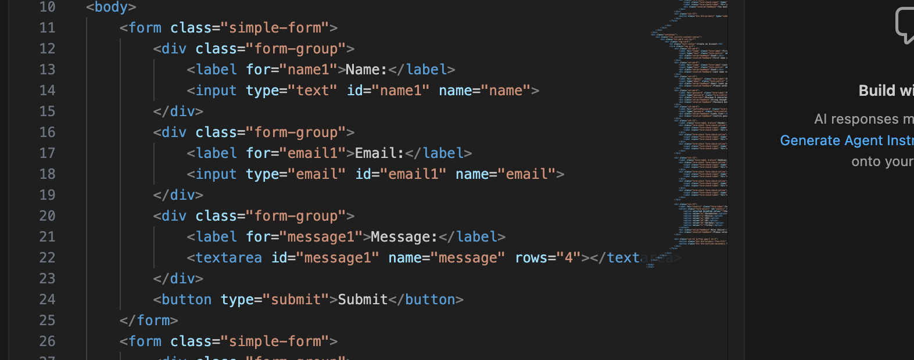
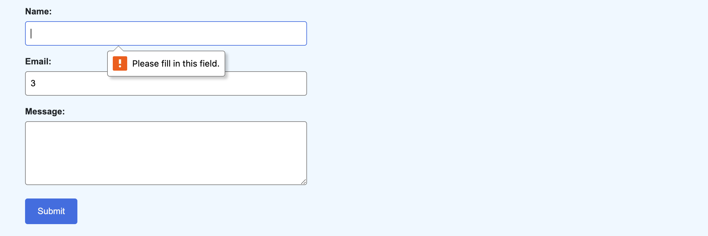
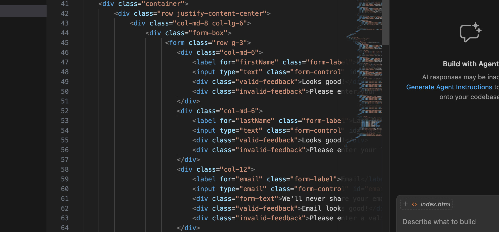
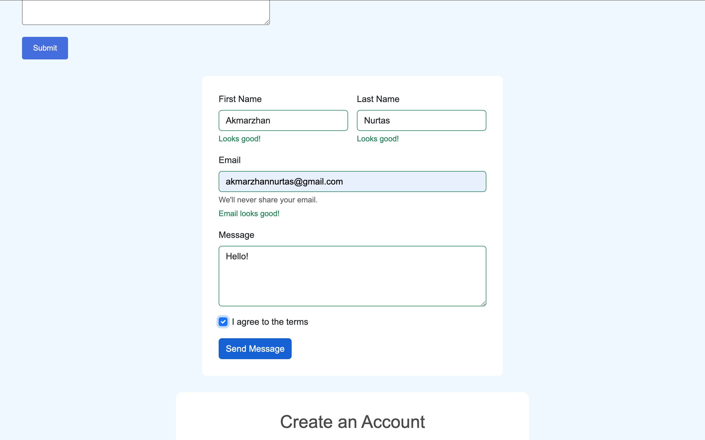
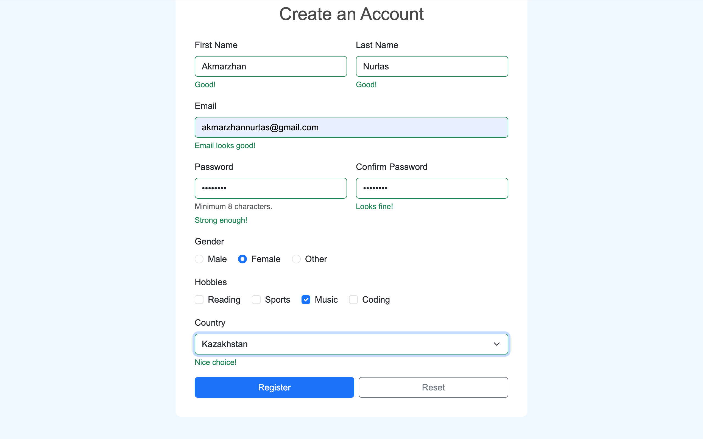

# Assignment 4 - Frontend Forms

**Name:** Akmarzhan Nurtas  
**Group:** SE-2538

---

## Tasks

- Task 0 - Simple contact form
- Task 1 - HTML5 validation
- Task 2 - Bootstrap styling
- Task 3 - Bootstrap validation
- Task 4 - Registration form

All files: `index.html`, `style.css`

---

## Task 0 - Simple Contact Form

Basic form with Name, Email, Message and Submit button. Every input has a label.

---

## Task 1 - HTML5 Validation

Added `required`, `type="email"` and `maxlength`. Browser shows errors if fields are empty or email is wrong.

---

## Task 2 - Bootstrap Form

Rebuilt the form with Bootstrap classes. Used grid (`col-md-6`, `col-12`) so it's responsive.

---

## Task 3 - Bootstrap Validation

Added `valid-feedback` and `invalid-feedback`. Green message for valid input, red for invalid. Since no JS, used CSS `:valid` and `:invalid` to show them.

---

## Task 4 - Registration Form

Full form: name, email, password + confirm, gender, hobbies, country, submit/reset.

HTML5 validation: `required`, `type="email"`, `minlength="8"`.

---

## Summary

I built the tasks one by one. First made a plain HTML form, then added HTML5 validation, then moved to Bootstrap for styling. For validation feedback I used CSS `:valid` and `:invalid` because I did not use JavaScript.

Note: password match and required radio group can't be checked without JS — that's an HTML5 limitation.